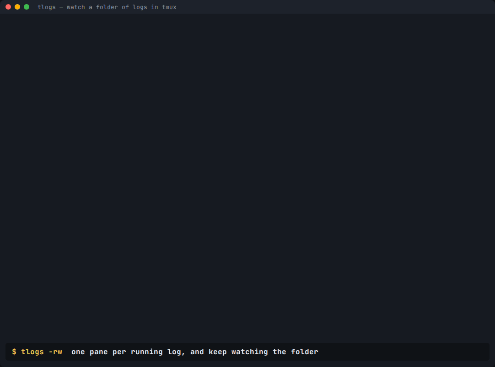

# tlogs

**Watch a whole folder of log files in one terminal.** tlogs opens one tmux pane per log, colours each line by keywords you choose, and labels every pane with the log's state: running, done, warn or failed.

```
cd /var/log/batch && tlogs -rw
```



*Label colours: blue = running, green = done (closes itself in watch mode), amber = warn, red = failed. `>` marks the pane you're on.*

It's one bash script on top of tmux. Nothing runs on your servers except `tail`, and there's no agent, daemon or database.

**What tlogs adds to plain tmux:**
- **One command, one pane per log.** Panes are tiled, labelled and coloured for you.
- **Your keywords, your colours.** Six colour rules (red, amber, yellow, green, blue, dim), each a regex. They work out of the box for PostgreSQL `ERROR / WARNING / NOTICE / LOG`, pg_upgrade and typical job logs.
- **A state for every log.** tlogs reads the last lines of each log for markers you define and labels it RUNNING, DONE, WARN or FAILED.
- **`-r` / `-e`** open only the logs still running, or only the ones that need a look.
- **`-w` (watch)** adds a pane when a new log appears and closes a pane a minute after its log finishes cleanly. Failures and warnings stay up.
- **Your terminal can drop safely.** tmux keeps the panes running, so if your SSH or SSM session times out, run `tlogs attach NAME` to get back.

---

## 1. Install

You need **bash 3.2+** (macOS's built-in bash is fine) and **tmux 3.0+**.

### Install tmux

| System | Command |
|---|---|
| macOS | `brew install tmux` |
| Ubuntu / Debian / WSL | `sudo apt-get install -y tmux` |
| Amazon Linux 2023, RHEL / Rocky / Alma 8+, Fedora | `sudo dnf install -y tmux` |
| Alpine | `sudo apk add bash tmux` |
| Amazon Linux 2, CentOS 7 | The packaged tmux is 1.8, which is too old. See [Older systems](#older-systems). |

Check the version with `tmux -V`. It should print 3.0 or higher.

### Install tlogs (pick one)

**A. With git.** Installs to `~/.local/bin`; no sudo needed.
```bash
git clone https://github.com/pavan-postgres/pavanpostgres.git && cd pavanpostgres/tlogs && bash install.sh
```

**B. Download just the script.**
```bash
mkdir -p ~/.local/bin && curl -fsSL https://raw.githubusercontent.com/pavan-postgres/pavanpostgres/main/tlogs/tlogs -o ~/.local/bin/tlogs && chmod +x ~/.local/bin/tlogs && ~/.local/bin/tlogs init
```

**C. No internet on the box** (e.g. a private EC2 jumpbox). Paste the script in directly:
```bash
mkdir -p ~/.local/bin && cat > ~/.local/bin/tlogs
# now paste the whole contents of the tlogs file, press Enter, then Ctrl-D
chmod +x ~/.local/bin/tlogs && ~/.local/bin/tlogs init
```

If `tlogs` isn't found afterwards, add `export PATH="$HOME/.local/bin:$PATH"` to `~/.bashrc` or `~/.zshrc`, then open a new shell.

`install.sh` never overwrites silently. If a different `tlogs` is already installed, it keeps it as `tlogs.bak.<timestamp>`. `tlogs init` writes `~/.config/tlogs/config` only when that file doesn't exist yet.

---

## 2. Use it

```bash
cd /path/to/logs
tlogs -l          # list every log with its state; opens nothing, safe first step
tlogs             # one pane per log
tlogs -r          # only logs still running
tlogs -e          # only logs that need a look (FAILED or WARN)
tlogs -rw         # running logs + watch for new ones (the batch-night mode)
tlogs -g 'postgresql-*.log'   # pick files (default '*.log')
tlogs -c ~/pg.conf            # use a config file for this run
tlogs /var/log/postgresql     # a folder instead of cd
```

Other commands:
```bash
tlogs ls                 # tmux sessions
tlogs attach NAME        # back into a session (after a dropped connection, too)
tlogs kill NAME          # close a session; asks twice, never touches log files
tlogs color FILE         # just colour one file, no tmux:  tlogs color app.log
tail -f x.log | tlogs color
tlogs config             # the settings in effect in this folder
```

**Inside tmux:**

| Keys | What it does |
|---|---|
| `Ctrl-b z` | Zoom the current pane full screen; press again to go back |
| `Ctrl-b` + arrows | Move between panes |
| `Ctrl-b n` | Open the `tl-watch` window (what `-w` added or closed) |
| `Ctrl-b d` | Detach; everything keeps running |
| `Ctrl-b [` | Scroll; `q` to leave |
| `Ctrl-b q`, then a number | Jump to that pane (the number is in its label) |

**With the mouse** (on by default, for tlogs sessions only):

| Mouse | What it does |
|---|---|
| Click a pane | Switch to it |
| Scroll up | Read back through that log; scroll to the bottom to go live again |
| Drag a pane border | Resize |
| Right-click a pane | Menu with **Zoom**, Kill, Swap and more |
| Click `logs` / `tl-watch` in the status bar | Switch window |

To copy text with the mouse on, hold **Option** (iTerm2) or **Fn** (Terminal.app) while you drag, then `Cmd-C`. Prefer keyboard only? Set `TL_MOUSE=0`. tlogs sets the mouse per session, so your other tmux sessions and `~/.tmux.conf` are not changed.

---

## 3. Make it yours: keywords and colours

Settings are plain `KEY=VALUE` lines. tlogs reads them as data and **never executes** them, so a config file left in a shared folder can't run code. Each colour rule is an extended regex (`grep -E` style).

A line is coloured by the **first rule that matches**, in this order:

| Setting | Colour | Default matches |
|---|---|---|
| `TL_RED_RE` | red | `PANIC: FATAL: ERROR:`, `Failure, exiting`, exception, Traceback, aborted, FAILED |
| `TL_AMBER_RE` | amber | `WARNING:`, `WARN` |
| `TL_YELLOW_RE` | yellow | `NOTICE:`, `HINT:` |
| `TL_GREEN_RE` | green | `Upgrade Complete`, completed successfully, SUCCESS |
| `TL_BLUE_RE` | cyan | (off) |
| `TL_DIM_RE` | dim | `DEBUG1-5:`, `STATEMENT:`, `CONTEXT:` |

Other display settings:
- `TL_HIGHLIGHT=word` colours only the matched keyword instead of the whole line.
- `TL_ICASE=1` makes every pattern case-insensitive.
- An empty value turns a rule off.
- `NO_COLOR=1` or `TL_NO_COLOR=1` turns colour off entirely.
- `TL_MOUSE=0` turns the mouse off for tlogs sessions (default `1`).

Some examples:
```bash
TL_BLUE_RE='duration: [0-9]{4,}\.'        # PostgreSQL queries slower than 1 s, in cyan
TL_RED_RE='ERROR|OOMKilled|CrashLoop'     # your own failure words
TL_GREEN_RE='deploy (done|succeeded)'
TL_BLUE_RE='LOG:'                          # if you want every LOG: line visible as cyan
```

### Log state: what "finished" means

| State | Rule |
|---|---|
| **DONE** | `TL_OK_RE` appears in the last `TL_TAIL_LINES` lines (default 10) |
| **WARN** | DONE, and `TL_WARN_RE` appears anywhere in the log |
| **FAILED** | `TL_FAIL_RE` appears in the last lines |
| **RUNNING** | anything else |

If your job prints a clear last line ("job finished", "exit code 0"), tlogs can track it. For logs that never end, like a database server log, set the three state patterns to empty so every log just shows as running.

### Where settings come from (highest wins)

1. Environment variables, e.g. `TL_ICASE=1 tlogs`
2. `-c FILE`
3. `.tlogs.conf` in the log folder, so each folder can have its own rules
4. `~/.config/tlogs/config`, created by `tlogs init` and fully commented
5. Built-in defaults

### Ready-made presets ([`examples/`](examples))

| File | For |
|---|---|
| `postgres-server.conf` | PostgreSQL server logs in stderr, csvlog or jsonlog format: `PANIC/FATAL/ERROR` red, `WARNING` amber, `NOTICE/HINT` yellow, `STATEMENT/DETAIL` dim |
| `pg_upgrade.conf` | One log per pg_upgrade run: `Upgrade Complete` = DONE, `Failure, exiting` = FAILED |
| `aurora-rds-downloaded.conf` | Logs pulled from Amazon RDS / Aurora with the AWS CLI |
| `batch-jobs.conf` | Migrations, backfills, deploys, ansible, cron: anything with "error / warn / done" |

Use a preset for one run, or copy it into a folder so that folder always uses it:
```bash
tlogs -c examples/postgres-server.conf /var/log/postgresql
cp examples/pg_upgrade.conf /data/upgrade-logs/.tlogs.conf
```

---

## 4. Recipes

**PostgreSQL server logs on a VM.** Logs are usually `/var/log/postgresql/` on Debian/Ubuntu, or `$PGDATA/log/` on RHEL-family systems. They're often readable only by the `postgres` user:
```bash
sudo -u postgres -i
tlogs -c ~/pg.conf "$PGDATA/log"
```

**Several pg_upgrade runs at once.** pg_upgrade prints its result to the terminal, so `tee` each run into its own file. Then watch the folder:
```bash
mkdir -p ~/upg && cd ~/upg && cp /path/to/tlogs/examples/pg_upgrade.conf .tlogs.conf
pg_upgrade ... 2>&1 | tee ~/upg/cluster-a.log &
pg_upgrade ... 2>&1 | tee ~/upg/cluster-b.log &
tlogs -rw
```

**EC2 through SSM Session Manager.** No SSH or open ports needed.
```bash
aws ssm start-session --target i-0123456789abcdef0
bash -l                      # SSM starts you in sh; switch to bash
cd /var/log/myjobs && tlogs -rw
# connection dropped or idle timeout? start a new session, then:
tlogs ls && tlogs attach tlogs-myjobs-running
```

**EC2 over SSH.** Same idea; tmux survives the disconnect:
```bash
ssh ec2-user@host -t 'cd /var/log/myjobs && ~/.local/bin/tlogs -rw'
```

**Copying the script to a private instance.** Use option C above (paste), or one of these:
```bash
aws s3 cp tlogs s3://my-bucket/tools/tlogs     # from your laptop
aws s3 cp s3://my-bucket/tools/tlogs ~/.local/bin/tlogs && chmod +x ~/.local/bin/tlogs   # on the box
```

**Amazon RDS / Aurora logs.** You can't log in to the host, so download the logs and watch them locally:
```bash
mkdir -p ~/rds && cd ~/rds && cp /path/to/tlogs/examples/aurora-rds-downloaded.conf .tlogs.conf
for db in db-1 db-2 db-3; do
  aws rds download-db-log-file-portion --db-instance-identifier "$db" \
    --log-file-name "$(aws rds describe-db-log-files --db-instance-identifier "$db" \
       --query 'DescribeDBLogFiles[-1].LogFileName' --output text)" \
    --starting-token 0 --output text > "$db.log" &
done; wait
tlogs
```

**Kubernetes pods.** Write each pod's logs to a file, then watch the folder:
```bash
mkdir -p ~/k && cd ~/k
for p in $(kubectl get pods -l app=myjob -o name); do kubectl logs -f "$p" > "${p#pod/}.log" & done
tlogs -w
```

**Just colour, no tmux.**
```bash
tail -f /var/log/postgresql/postgresql-16-main.log | tlogs color
```

---

## Older systems

- **Amazon Linux 2 / CentOS 7** ship tmux 1.8. Amazon Linux 2 reached end of standard support on 30 June 2026, so the cleanest fix is moving the jumpbox to Amazon Linux 2023 (`dnf install tmux`). Other options:
  - Run tlogs from any newer machine that can read the logs (over NFS, `aws s3 sync`, or downloaded with the AWS CLI).
  - Build tmux 3.x from source.
- **Container-only hosts** (Bottlerocket, Flatcar): run tlogs inside a shell or admin container that has bash and tmux and can see the log folder.
- **No tmux at all?** `tlogs -l` (states) and `tlogs color` (colours) work without tmux.

## Troubleshooting

| Problem | Fix |
|---|---|
| `tmux 3.0+ needed` | Upgrade tmux (see the table above). |
| `no room for another pane` | Your terminal is too small for that many panes. Make the window bigger, or use `-r` / `-e` to open fewer. |
| No colours | Your terminal or `TERM` needs 256-colour support (most do). Check you haven't set `NO_COLOR` or `TL_NO_COLOR=1`. |
| Everything shows FAILED for server logs | Server logs contain `FATAL:` lines in normal operation. Use `postgres-server.conf`, which turns state checks off. |
| Session already exists | `tlogs attach NAME` to reuse it, or `tlogs kill NAME` and run again for a fresh list. |

## Test

```bash
bash tests/test.sh          # 38 checks: colours, states, config safety, tmux panes, mouse scope, watch mode
```
CI runs the same tests on Ubuntu and on macOS, including macOS's built-in bash 3.2.

MIT licensed.
